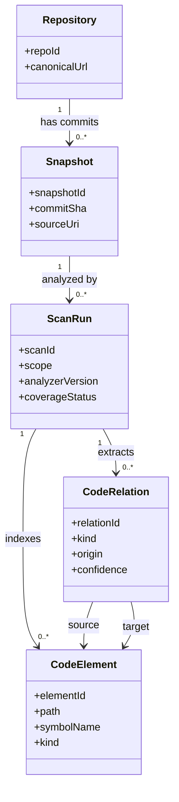
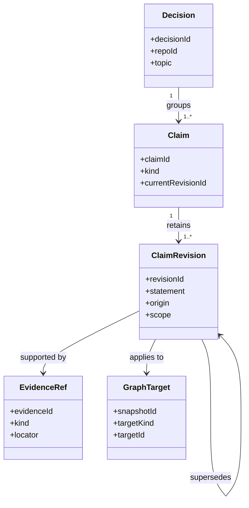
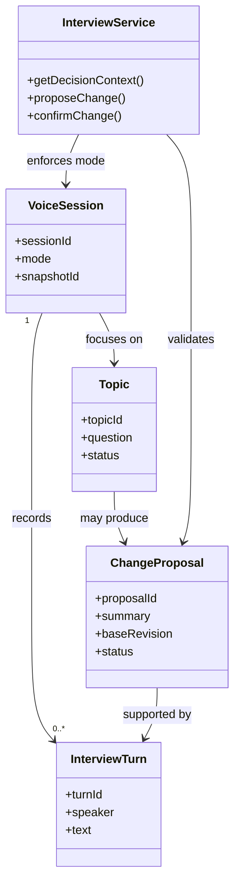
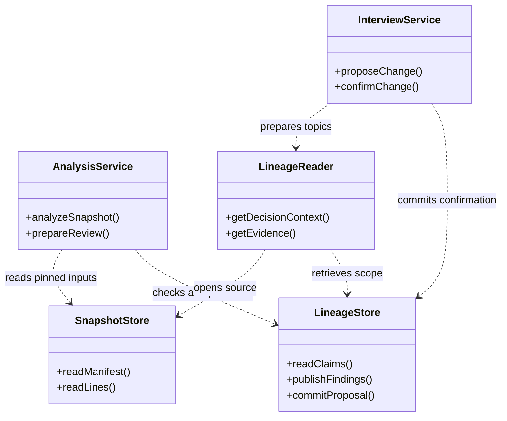
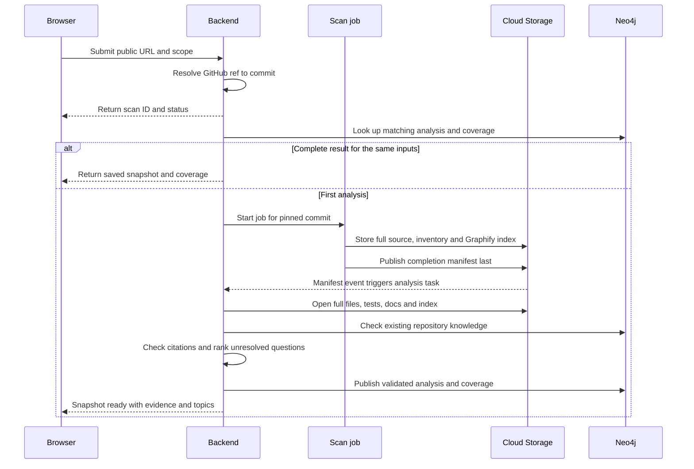
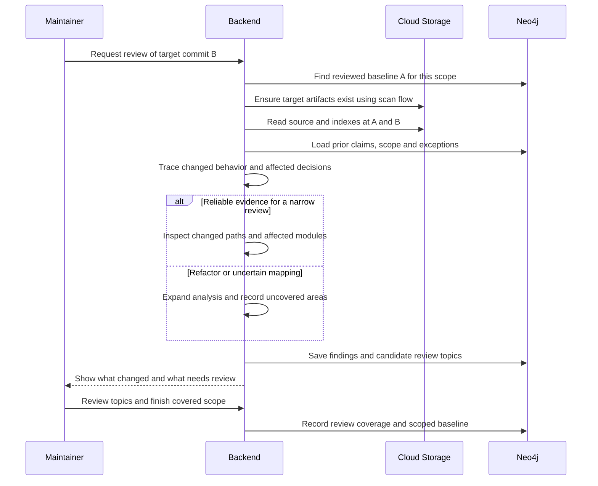
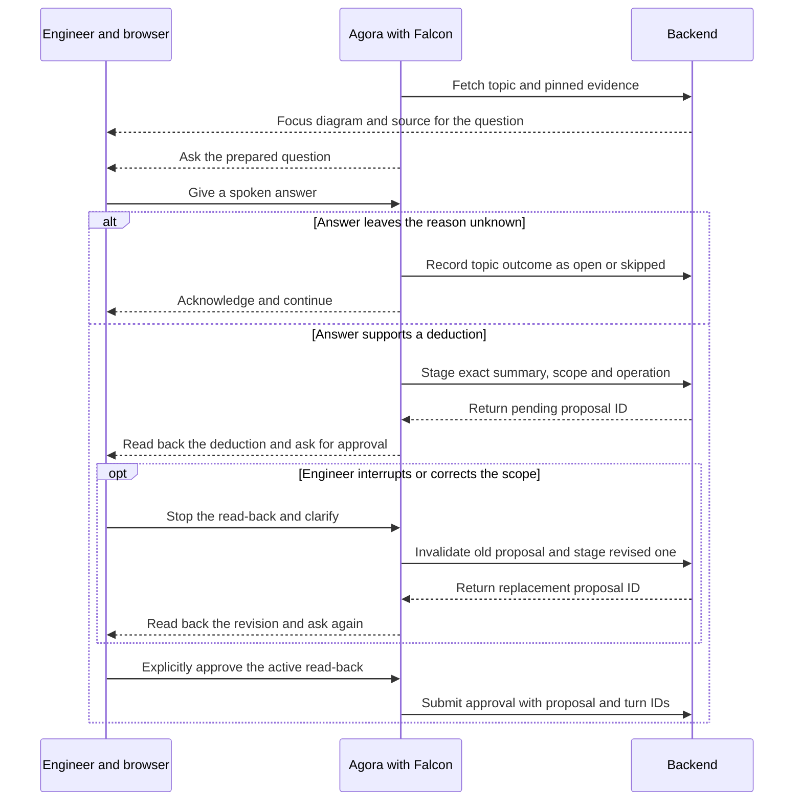
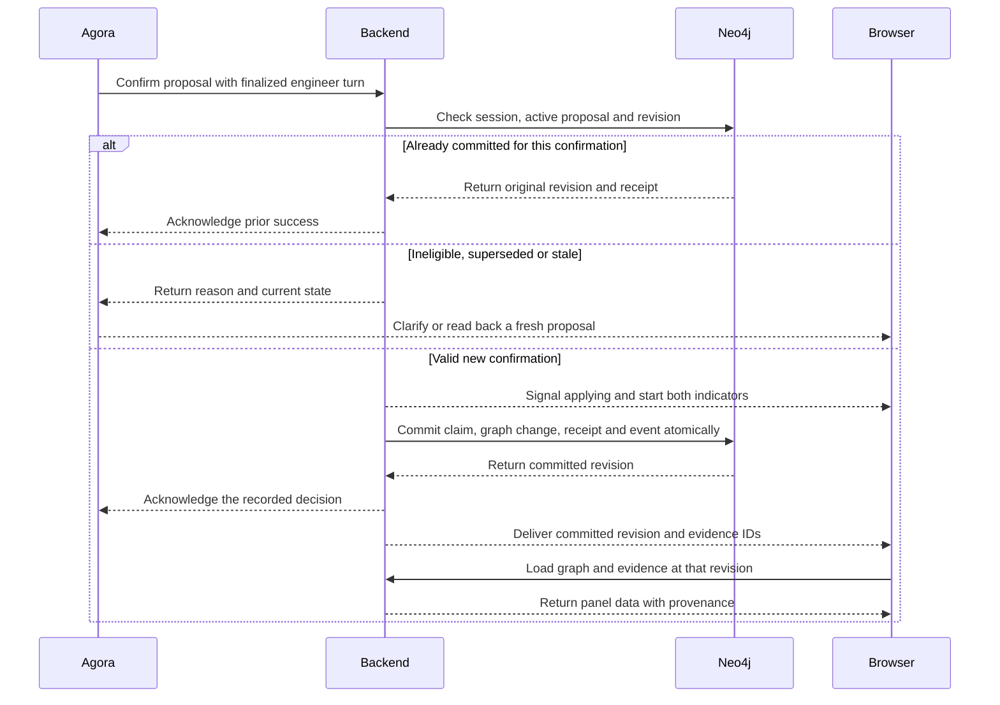
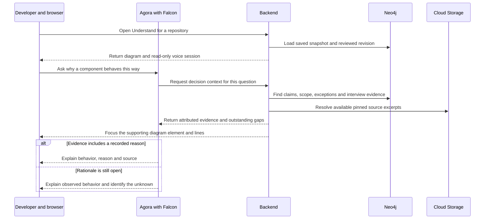

# Build with Agora Bengaluru 2026 — Architecture interview assistant

Design decisions, class and sequence diagrams, and build handoff · 19 November 2026 · Phase 1, ready for review

**Submission target:** 21 November 2026 at 12:30 PM IST. Solo project for Track 2, “Voice AI at Work: Beyond the Call Center.” [Hackathon brief](https://www.commudle.com/communities/knotic/hackathons/build-with-agora-blr/tracks)

## Product and working agreement

A maintainer connects a repository. The app maps the architecture, reads the code and documentation, and identifies consequential decisions whose rationale is still unclear. A voice agent interviews the maintainer while the diagram and relevant source lines are visible. A second developer can open a fresh session and retrieve the reviewed explanation from the shared knowledge base.

The design decisions and product journeys below lead into the consolidated implementation blueprint at the end of this document. Implementation begins when the user approves it and says **“Start building.”** Then implement and verify the application in one pass. If credentials are missing, continue independent work and identify the specific blocked verification.

## Implementation guide

Use the decision ledger to understand **why**, the class diagrams to decide **where a change belongs**, and the sequence diagrams to trace **who acts and when**. The two homepage actions and eleven approved decisions form the product contract. Class names, endpoint shapes, event names, and limits below are implementation defaults for blueprint review.

- [Decision ledger and trade-offs](#decision-ledger-and-trade-offs)
- [Class diagrams](#class-diagrams)
- [Sequence diagrams](#sequence-diagrams)
- [Interface and failure contracts](#interface-and-failure-contracts)
- [Reference repository for the demo](#reference-repository-for-the-demo)
- [Consolidated implementation blueprint for approval](#consolidated-implementation-blueprint-for-approval)

### One screen shared by both modes

| Diagram panel · left two-thirds | Evidence panel · right third |
|---|---|
| Selected component or connection, its label, and the origin of the claim | File path, commit, line numbers, and the highlighted excerpt for that claim |
| After confirmation, progress while the graph revision is applied | After confirmation, progress while evidence for that revision is loaded |

The voice area spans the bottom. In create/update mode it shows the current question, the engineer’s answer, and the agent’s short read-back awaiting confirmation. In understand mode it shows the developer’s question and the answer with evidence. Selecting a topic or asking to see a file can move the focus. Speaking an unconfirmed correction leaves the graph and evidence displayed for that topic in place.

### Responsibilities at a glance

| Component | Owns | Output used by the next component |
|---|---|---|
| React/TypeScript client | Microphone session, graph selection, evidence view, progress and reconnect | Spoken input, navigation events, and a view of the server’s current revision |
| FastAPI backend | Intake, snapshot lookup, analysis orchestration, voice tools, validation, graph writes and browser events | Commit-pinned findings and a consistent projection for the two panels |
| Cloud Run scan job | Fetch the pinned public tree and run our packaged Graphify and parsers | Complete source snapshot, inventory, structural index and a final completion manifest in private Cloud Storage |
| Backend analysis agent | Search full source, tests and docs, follow indexed relationships, consult previous decisions and assess gaps | Candidate findings with supporting or conflicting evidence, coverage, and ranked open questions |
| Neo4j | Versioned claims, scope, exceptions, interview provenance, session/proposal state, accepted revisions and review baselines | A queryable explanation shared across fresh sessions |
| Agora and Murf | Agora manages live conversation and tool calls. Murf Falcon speaks the agent’s replies. | A spoken question, read-back or answer tied to the backend’s current topic |

## Decision ledger and trade-offs

Numbers refer to the approved decisions below. The last column explains what would justify revisiting the choice after the hackathon.

| Decision | Trade-off and builder instruction | Revisit when |
|---|---|---|
| 1 and 8 · execution boundary | A single web process would be simplest, but scanning a large repo could compete with a live interview. Keep one application codebase, run static extraction in a separate job, and perform LLM reasoning in the backend where both snapshots and Neo4j are available. The job installs our parser dependencies at image-build time and reads the submitted project as data. | Multiple independent analysis workloads require different scaling or deployment lifecycles. |
| 2 · what counts as knowledge | Graphify describes structure. A documented reason, a model inference, and a participant’s explanation are separate claims with different evidence. SQLite could store the same links in join tables. We chose Neo4j because our main questions traverse code paths, decision scope, evidence and local exceptions, including modules that share a decision without calling each other. The agent requests context from the backend. It never has to write a recursive database query itself. | Retrieval tests show we cannot find relevant claims across paths or across disconnected modules. |
| 3 and 4 · how knowledge changes | A fixed questionnaire would miss useful corrections. Unrestricted redraws could turn a misheard statement into shared history. Prepare topics, ask adaptive follow-ups, and make the engineer approve a short, scoped deduction before changing either panel. | Further user research changes the explicit-confirmation requirement. |
| 5 · voice tools | Direct HTTPS tools let the existing backend enforce mode, proposal identity and evidence checks. We considered MCP for reuse and deferred it because there is one tool consumer in the MVP. | Another agent or product needs to consume the same tool interface. |
| 6 · screen layout | A transcript-first layout would hide code during the conversation. Keep diagram and source visible together, with voice and pending deductions below. | A different device or workflow makes simultaneous inspection impractical. |
| 7 · intake | A pinned public GitHub URL provides reproducible source links. ZIP uploads and private-repo installations add another intake and access path. | The project needs unpublished or private source. |
| 9 · stack and submission | The Python API and scanner can share source-reference schemas. React/TypeScript handles interactive graph state. A single GitHub repo can build both a service and a job. Backend runtime speed has not been benchmarked. | Measurements identify a real bottleneck or a new deployment requirement. |
| 10 · entry and output | Users choose an action directly. Both modes share one repository lineage. Only create/update may mutate it. A shared graph already supports future developers, so generating Markdown ADRs and opening GitHub PRs were removed from the app’s MVP. Interview evidence identifies the speaker/session as available. It does not certify upstream maintainer identity. | Teams request repository-native review, export, or verified upstream authorship. |
| 11 · reference and coverage | Healthchecks provides real, pinned code and an independently published rationale. Python is the demonstration language. Public repositories in other languages enter the same pipeline with coverage disclosed per file. | A new evaluation target exposes an unsupported parser, missing evidence, or a weak question. |

## Approved decisions

| # | Decision | Reason |
|---|---|---|
| 1 | Use a modular monolith for the application backend. Decision 8 moves static extraction into a separate execution of a Cloud Run Job. | Keeps interview state and knowledge management together while isolating repository scans. |
| 2 | Use Graphify for code structure, an LLM to interpret the repository, and Neo4j for the shared knowledge base. Adapt the evidence and documentation-gap approach from architecture-skills. | Capture the reason behind a choice, where it applies, and what remains unknown, including across disconnected modules. |
| 3 | Prepare interview topics from unresolved findings. Allow adaptive follow-ups. | Every topic has source evidence. A follow-up is worthwhile when it could change the rationale, scope, exception, or affected components we record. |
| 4 | Support annotations and proposed component or connection changes. Ask for confirmation of the agent’s deduction before changing either panel. | The engineer can correct a misunderstanding before it appears in the architecture. |
| 5 | Use Agora Conversational AI, Murf Falcon TTS, and direct HTTPS tools exposed by the backend. | Direct tools keep context lookup and diagram updates within the existing deployment. MCP can be reconsidered if a new consumer or integration need arises. |
| 6 | Diagram on the left, code on the right, voice below. Show progress at the top of each panel while applying a confirmed change. | The maintainer can inspect the question’s evidence and see exactly what changed after confirmation. |
| 7 | Accept a public GitHub repository URL and resolve it to a commit SHA. | The scan and source citations refer to the same reproducible snapshot. |
| 8 | Run snapshot capture and Graphify in a Cloud Run Job, then perform semantic analysis and persist validated findings in the backend. | The analyzer retains access to the whole commit and to prior decisions after the scan job exits. |
| 9 | Use Python and FastAPI for the backend and analysis agent, and React with TypeScript for the frontend. Keep both in one GitHub submission repository. | A shared Python codebase serves the API and the scanner entry point. The React UI can consume typed API responses and render interactive diagram updates. |
| 10 | Put exactly two actions on the homepage: **Create or update code lineage** and **Understand code lineage**. The same person can choose either. | The first starts an interview that can update shared repository knowledge. The second opens the diagram, source code, and voice Q&A for an existing lineage. |
| 11 | Use Healthchecks as the public reference application, with alert delivery as the example subsystem. | A missed check-in is easy to explain, and the project has inspectable code and a published account of a real design trade-off. |

**MVP output.** A reviewed decision becomes available to other developers through the shared graph. An earlier concept ended with a Markdown decision record and a GitHub draft PR. The agreed MVP ends with the reusable graph entry. This document is the project owner’s implementation handoff.

## Homepage and user journeys

The two actions open the corresponding flow directly. Repository selection belongs inside the chosen flow. The entry point requires no user-role selection, workspace setup, or sharing-link workflow.

1. **Create or update code lineage.** Take the public GitHub URL and identify its saved review, if any. For a new repository, prepare questions from the first analysis. For a returning repository, use the current snapshot and prior review to prepare relevant questions. Start the voice interview as soon as its evidence is ready. Listen, summarize the proposed change, and ask for explicit confirmation before updating the shared lineage and refreshing the two panels.
2. **Understand code lineage.** Open the saved lineage for the selected repository with the diagram on the left, source code on the right, and voice chat below. The user asks questions and the agent answers aloud, focusing the diagram and supporting lines as appropriate. Answers distinguish code evidence, interview-confirmed rationale, and unknowns. This flow exposes lookup and navigation tools only. When no lineage exists, explain that and point to the existing create/update action.

Both flows use the same repository knowledge. An interview confirmation records what the speaker confirmed and carries no claim of verified upstream maintainer identity.

## How knowledge is created and retrieved

1. Pin each repository analysis to a commit. Graphify produces a structural map in `graph.json`. Preserve source locations, relationship direction, and the distinction between extracted and inferred relationships.
2. Run a separate LLM analysis stage over the relevant code, tests, configuration, comments, READMEs, and existing decision records. Verify the exact statements behind each question at the pinned commit. A function definition alone may be too broad to support a behavioral claim.
3. Store observations, candidate decisions, affected components, exceptions, source references, open questions, and maintainer explanations in Neo4j. Each significant claim carries its source and status. A correction can supersede an earlier interpretation while preserving its history.
4. A shared decision may govern two modules with no call path between them. Similar implementations can suggest a connection. Evidence or maintainer confirmation establishes its scope. A confirmed exception belongs to its specific component. If code and stated intent disagree, preserve both accounts.
5. Give the agent a backend context lookup that retrieves relevant paths, decisions, documents, and exceptions. For a five-function chain, return the supported hops in order and identify uncertain links. Related documentation may sit outside the chain. Semantic search remains an optional way to find candidate connections.

**Question selection.** Ask what a future engineer might change and which missing information could affect that choice. Skip questions the reviewed material already answers. “I don’t know” leaves the rationale open.

## Interview and screen behavior

1. Open the current topic, highlight its diagram element, and show the exact source lines for the question. Put the current speaker, question, and voice controls below the two panels. The full transcript can expand there.
2. Listen to the engineer’s full answer. State the deduction in **one or two lines**, including its scope when relevant. Ask for explicit confirmation. Keep the diagram and evidence panel in their prior state during this exchange.
3. If the engineer corrects the deduction, revise it and ask again. A pause, interruption, skipped question, or “I don’t know” cannot confirm a change. The pending summary can be shown in the voice area.
4. After confirmation, apply the reviewed update and show progress at the top of both panels. The diagram indicator describes the annotation or structural update. The code indicator describes refreshing the evidence or highlighted lines. Repository source stays read-only.
5. Display the revised diagram with stable positions around the affected element. Label a maintainer-only claim with its attribution. Where matching code exists, show the supporting lines too. If saving or loading evidence fails, report the outcome accurately.
6. A developer in a new session can retrieve the confirmed explanation, its scope, and its sources.

**Latest revision.** Earlier sketches showed a draft annotation or a dashed connection on the diagram before confirmation. The approved sequence keeps the proposal in the conversation until the engineer confirms it. This applies to annotations, components, and connections.

### Example to carry forward

The code shows that signup queues a welcome email. The maintainer explains that a slow provider once delayed signup. The agent asks, “I understood that welcome emails run in the background so provider delays don’t hold up signup. Should I record that for welcome emails?” On confirmation, the diagram gains that rationale and the code panel highlights the enqueue operation. The code supports the observed behavior. The interview supports the reason. A future developer can ask what would happen if the email were sent inline and recover both sources. The signup example illustrates the interaction. The pinned Healthchecks example below is the reference for the demo.

## Integration notes

Agora runs the voice session and can call synchronous HTTPS tools on our backend. Murf supplies Falcon speech using a project-owned Murf API key. The proposed tools include `getDecisionContext` and `proposeChange`. The sequence diagrams and interface contracts below specify approval, retries, and browser updates. Official documentation was reviewed during design. Actual credentials, audio, interruption handling, and tool execution still need build-time verification.

[Graphify](https://github.com/Graphify-Labs/graphify) · [architecture-skills](https://github.com/cdvel/architecture-skills) · [Neo4j property graph model](https://neo4j.com/docs/getting-started/appendix/graphdb-concepts/) · [Agora custom tools](https://docs.agora.io/en/ai/platform/build/tools/custom-tools) · [Agora Murf integration](https://docs.agora.io/en/ai/platform/models/tts/murf) · [Murf streaming TTS](https://murf.ai/api/docs/text-to-speech/overview)

## Knowledge and interaction invariants

- A question opens the precise source lines that support it. The app distinguishes code evidence, an inference, a maintainer’s explanation, and an open question.
- A five-function path can be followed through verified links. A relevant document outside the path is discoverable. A disconnected module retrieves a confirmed shared decision and its own exception.
- Before confirmation, an answer can be corrected without changing either panel. After confirmation, both panels show progress, the intended change is applied once, and matching evidence or attribution is visible.
- A fresh session can retrieve the reviewed explanation. Skipped or unknown answers remain unresolved.

## Repository processing

1. The Cloud Run Job fetches the pinned public commit. Its image supplies Graphify and the parser dependencies. It reads the submitted project's source without installing its packages or executing its scripts. It saves the complete source snapshot and scan index in private Cloud Storage.
2. After those artifacts are complete, the backend analysis agent reads the index, opens and searches full files, checks documentation, and retrieves relevant repository knowledge from Neo4j. An existing complete scan can be reused.
3. The backend validates the findings and writes them to Neo4j with commit, scope, evidence, and source attribution. A proposed rationale stays an inference or an open question. Explicit confirmation during the interview is recorded separately. Persistence is a backend operation and can be retried without duplicating findings.

- On first import, inventory the tree and analyze supported first-party code and relevant tests, documentation, configuration, and migrations module by module. Follow cross-module references and record evidence, coverage, and unknowns. The scan output identifies the repository and commit, snapshot location, file paths and hashes, languages, symbols, relationships, source ranges, and parser coverage or failures. Store the underlying files independently of any generated summary.
- For a later review, the maintainer chooses when to reassess. Compare the last reviewed commit with the chosen current commit, even when many intermediate commits exist. Keep both complete snapshots readable. Use changed files, symbol and relationship changes, affected callers, and decision-scope links to prioritize reading. Widen to a full analysis when a major refactor makes incremental matching unreliable. Retain confirmed rationale, flag questionable applicability for review, and advance the reviewed baseline only according to the review’s actual coverage.

## Reference repository for the demo

Use [Healthchecks](https://github.com/healthchecks/healthchecks), a Python/Django service for detecting when scheduled jobs stop checking in. GitHub displayed about 10.5k stars and a BSD-3-Clause license on 19 November 2026. Analyze the full supported source tree. Focus the interview on alert delivery after a missed check-in.

Pin the demo to [v5.0.3](https://github.com/healthchecks/healthchecks/releases/tag/v5.0.3), commit `51a503531d845fc11d5ef270d576c59c300e3620`. The channel model [records a delivery duration](https://github.com/healthchecks/healthchecks/blob/51a503531d845fc11d5ef270d576c59c300e3620/hc/api/models.py#L1179-L1185). The alert logic [orders eligible channels by duration](https://github.com/healthchecks/healthchecks/blob/51a503531d845fc11d5ef270d576c59c300e3620/hc/api/models.py#L1407-L1409), putting shorter known times first and channels with no previous measurement last.

The maintainer’s [webhook delivery write-up](https://blog.healthchecks.io/2024/10/how-healthchecks-io-sends-webhook-notifications/) describes slow destinations delaying other users’ alerts. Use the write-up to verify historical rationale. During the interview, skip any question already answered by the analyzed material. One possible remaining question is how to treat a new destination that lacks delivery history. Label demo answers as the participant’s explanation and attribute statements about upstream intent to the published source.

## Class diagrams

These views describe logical classes in the proposed Python backend. A class can be a small typed record. The GCS snapshot contains source bytes, while its Neo4j record identifies the snapshot and its relationships. Repeated class names refer to the same concept across views.

### A. Repository, scan and code structure

One commit fixes the source text. Several scans of that commit can cover different scopes or parser versions. A structural edge retains its direction, relation type and extraction confidence.

The manifest tracks files even when they have no indexed symbols. Element references include their snapshot or scan. When a symbol is renamed, store the evidence for a cross-version match separately. A matching name alone cannot carry forward a reviewed claim.

### B. Decisions and the evidence behind them

The unit of knowledge is a scoped claim. Several claims can describe one architectural decision. A revision keeps the actual text and supporting evidence, so a reader can ask why a rule applies to one module and whether another module is an exception.

A target identifies a component or a connection. An open topic may exist with no decision yet. Evidence is typed: a code citation has commit, file and line range; a document citation identifies the version and passage; an interview citation identifies the session and finalized turn. Keep contradicting claims and their evidence visible. A later change to implementation does not erase what the engineer originally explained.

### C. Interview state and write authority

The backend owns each pending proposal. It binds approval to the exact words read back and to the graph revision the engineer was reviewing.

Each proposal also stores its operation, target and scope, originating answer, read-back turn, and any confirming turn. A correction creates a new proposal ID and supersedes the old one. A single confirmed answer may create several related graph changes in one transaction. Understand mode can call the context and evidence readers only.

### D. Backend services and dependencies

The API dispatches requests to these services. The interfaces keep file access and graph persistence explicit. The scanner has its own entry point and writes artifacts through the snapshot interface. The read service is usable independently of an interview.

The FastAPI handlers enforce session access and bind the allowed tools to the selected mode. They pass validated input to these services. Only the backend constructs database operations. The model requests named actions with bounded arguments. The browser receives a projection for a named revision and cannot change a claim directly.

## Sequence diagrams

Read these in workflow order. “Backend” includes the FastAPI handlers and resumable analysis work in the same application. Each arrow represents a logical call or event. The service can restart between tasks because the snapshot, task checkpoints, and committed graph are durable.

### 1. First import and analysis

The scan job can exit as soon as the artifacts are durable. The analysis agent has access to the entire captured source, including files Graphify could not parse. For a partially completed scan, the backend returns its coverage and reason. A new session uses only available, cited findings. Reusing an artifact can save extraction time even when a new analysis version requires rerunning semantic analysis.

### 2. A maintainer requests a later review

A request can span dozens of commits. The comparison follows changed source, structural relationships, and stored decision scope. For example, if one service changes its timeout policy, look up other modules covered by that policy even if they never import the changed service. A new scan preserves the earlier reviewed explanation. Move a scope’s baseline only after its review is completed. An unfinished scope keeps its earlier baseline, and unanswered questions remain open.

### 3. Interview, interruption and correction

The last two arrows apply only if the engineer actually approves. A pause, ambiguous “yes” to a different question, or interrupted read-back leaves the change unapplied. If a correction only withdraws the statement, retire the proposal and leave the question open. The agent can ask an adaptive follow-up whenever an answer leaves a consequential ambiguity. Any deduction the follow-up changes needs a fresh read-back. Pending text appears in the voice area. Neither panel previews a proposed change.

### 4. Apply one confirmed change and refresh both panels

The write checks the expected revision **inside** the transaction too. A concurrent edit can win after the initial check. In that case stop the indicators, keep the preceding view, and explain that the proposal needs review against the latest revision. A successful save followed by a failed evidence fetch is reported as saved, with a retry on the code panel. A browser that reconnects reads the current server state and resumes from the last event ID.

### 5. A new developer asks the shared lineage a question

When the reason comes solely from an interview, show the speaker attribution and turn alongside any code that supports the behavior. References to the explanation and the implementation can point to different evidence. If the repository has no saved lineage, return the empty state and link to the existing create/update action before opening a voice session.

## Interface and failure contracts

These are proposed application contracts. Provider adapters translate vendor payloads into the application’s session, turn and event IDs. The frontend and API can be developed against the same examples before credentials are available.

### Requests, tools and durable effects

| Call | Essential input | Successful outcome and boundary |
|---|---|---|
| `POST /scans` and `GET /scans/{id}` | Public repo URL, optional ref and directory scope | Resolve the commit, then return a scan ID. Return 202 for queued work and indicate cache reuse explicitly. Poll for state, coverage, and a ready snapshot. A completed static scan can still have semantic analysis pending. |
| `GET /snapshots/{id}/graph` and `GET /snapshots/{id}/source` | Snapshot ID, graph revision for diagram data, file path and inclusive line range for source | Return stable element IDs, edges and provenance, or the exact numbered excerpt. Source belongs to the pinned commit. Reject a path absent from its manifest or an invalid range. A code citation can be checked without rerunning an LLM. |
| `POST /sessions` and `GET /sessions/{id}` | Mode, repo and selected snapshot or saved lineage | Bind the session to repo, snapshot, current revision and permitted tools. The response or a refreshed state includes current topic, pending proposal if applicable, event cursor, and voice join information as needed. Missing lineage in Understand opens the existing two-action flow’s empty state. |
| `POST /sessions/{id}/finish` | Session and reviewed topic IDs | Finalize the recorded review coverage. Advance only completed scopes to the pinned snapshot and retain pending questions. Ending a read-only session never advances a review baseline. |
| `getDecisionContext` and `showEvidence` | Session, topic or question, optional target or evidence IDs | Return scoped claims, citations, gaps and exceptions. Evidence navigation can change the user’s selection. Neither tool writes repository knowledge. |
| `proposeChange` | Session, topic, finalized answer-turn ID, target, scope, operation, exact summary and expected revision | Create a pending proposal. Return its ID and exact text for the agent to read back. Allowed operations include annotating a node or edge, adding a component or connection, and correcting or superseding an existing claim or relationship. Bind the full proposed change set to that ID. |
| `confirmChange` | Session, active proposal ID, completed read-back turn and later finalized assent-turn ID | Verify mode, speaker, turn order, read-back completion, lack of subsequent correction, and expected revision. Commit the prepared change set once. Return the saved revision and receipt. A timeout after the write can be retried using the same IDs. |
| `GET /sessions/{id}/events` | Session authorization and last received event ID | Stream ordered UI updates over server-sent events. The client can fetch authoritative session state to recover from a lost event or an expired cursor. |

The backend records final transcript turns and delivery or interruption signals from the voice integration as session state. Treat the model’s tool arguments as references to those records. An agent-generated “yes,” a partial transcript or an ambiguous response cannot authorize a save. If read-back delivery or assent cannot be correlated, keep the proposal pending and ask again. Verify the actual Agora event mapping and interruption ordering in the live integration.

### How a confirmed change appears

Every rendered element has a stable ID, a scope, and an origin. The extracted graph remains the reproducible output of the scanner for that commit. The backend combines that graph with committed claims to produce the diagram for a specific revision.

| Approved operation | Diagram effect | Evidence-panel effect |
|---|---|---|
| Annotate an existing component or connection | Attach the scoped rationale to that element. Keep its ID and position. | Highlight the source for the observed behavior and show the confirming interview turn for the reason. |
| Add a component | Add a scoped node with the engineer’s label and provenance. Place it near the affected element. | Show the cited source when available. If the component is an external service known only from the interview, show the attributed turn. |
| Add or correct a connection | Add the directed edge with its relationship type, or supersede the earlier interpretation. Mark disagreement with an extracted edge when relevant. | Show the excerpts supporting the endpoints or behavior and any turn establishing the relationship. |
| Correct scope or add an exception | Update only the affected scope and retain the superseded claim for history. | Identify which source or interview turn establishes the exception. Other modules retain their existing rationale. |

### Which questions earn interview time

For each candidate, store the observed behavior, its commit-pinned evidence, the docs and tests checked, the unresolved part, the affected scope, and what a future engineer might change based on the answer. Discard a candidate when a source already answers it. Merge duplicates that would produce the same scoped decision. Prioritize an unresolved design choice that affects behavior across components, reliability, or a meaningful exception. Start with the highest-impact question the evidence supports. When a diagram link itself is uncertain, ask whether the link exists before asking why it was chosen.

### State and recovery

| State or event | What the implementation must preserve |
|---|---|
| Static artifacts complete | The completion manifest identifies commit, scope, hashes, extraction version, source and index locations, and coverage. The analysis handler checks it before reading. Duplicate object events or retries reuse durable work. |
| Analysis ready, partial, or failed | Publish only validated observations and inferences, with evidence and coverage. An incomplete run never overwrites the last complete analysis. Reuse a cached semantic result only if its inputs, scope, versions and relevant prior-knowledge revision match. |
| Question open or skipped | Record conversational progress separately from an architecture decision. “I don’t know” can keep a question available for the next review. |
| Proposal pending, superseded, or withdrawn | The voice area may display the summary. The diagram and code stay on the current topic. A correction invalidates the old ID immediately. A response from an older turn cannot revive it. |
| Confirmation accepted for processing | Emit an applying event only after explicit assent clears initial validation. Both panels show progress. If the transaction fails, clear the indicators and retain the last committed view. A conflicting revision requires a fresh review and explicit confirmation. |
| Change committed | Store the claim revision, scope links, citations, graph edits, proposal receipt and durable commit event in one transaction. Replaying the request returns the existing receipt. Historical source and claims remain inspectable. |
| Browser reconnect or slow response | Session events carry `eventId`, an increasing per-session `seq`, `type`, `sessionId`, `snapshotId`, and the applicable graph revision. Discard old panel responses. Fetch current state on a sequence gap, then resume streaming. Show an evidence-load failure against the saved revision so retrying the fetch cannot duplicate the edit. |

### One proposed change, worked through

Suppose a participant reviewing Healthchecks says, “For our deployment, we accept that a new channel waits behind channels with measured delivery times.” This is an illustrative interview answer. It makes a claim about that participant’s deployment. It supplies no new upstream historical evidence.

| Stage | Concrete data and consequence |
|---|---|
| Code evidence | At the pinned release, `hc/api/models.py:1407–1409` orders eligible channels by measured duration, with unknown durations last. The measurement is recorded at `hc/api/models.py:1179–1185`. Both line links are given in the reference section. |
| Question | “The query puts a channel with no measurement last. What trade-off does your deployment accept for that first alert?” Ask it only if the available sources leave this point open. |
| Read-back | “Your deployment accepts that a new channel can wait behind measured channels for its first alert. Should I record that scope?” Example proposal `p17` references answer `t8`, the alert-delivery target and graph revision `r6`. The existing diagram stays at `r6`. |
| Correction | If the participant says “Only for webhooks,” supersede `p17`, narrow the target to webhooks, and read back proposal `p18`. The correction is the originating answer for the new proposal. Request approval again. |
| Confirmation | A later explicit yes to the completed read-back of `p18` commits `r7`. Replaying that confirmation returns `r7`. A late confirmation of `p17` is rejected. |
| Later question | A fresh Understand session shows the ordering in code and attributes the narrower acceptance to the participant. A question about email channels returns the code behavior and the unresolved deployment rationale for email. |

### Build handoff and verification

| Boundary | Check from a normal entry point | Observable result |
|---|---|---|
| Ingestion and analysis | Import the pinned Healthchecks URL, then submit it again. Use a mixed-language fixture where one text file lacks structural parsing. | Source links open the exact commit and range, repeated work is identified, and coverage distinguishes parsed files from reviewed text. |
| Knowledge retrieval | Ask about a five-hop chain and a shared rule covering two disconnected modules, one with an exception. | The answer exposes supported hops and retrieves the scoped rule and exception, with evidence for each. |
| Interview and storage | Interrupt a read-back, correct its scope, try an old confirmation, then approve the revised one. Simulate a lost response and retry. | Both panels stay stable until valid approval. Exactly one new revision is visible afterward. The old proposal and preceding revision are traceable. |
| Returning repository | Open a review that spans multiple commits and includes a renamed symbol plus an unchanged module governed by the same decision. | The reviewer sees changed evidence, relevant prior rationale and unresolved matches. Unreviewed scopes retain their own baseline. |
| Fresh read-only session | Open Understand in another browser session, ask for the reason and then ask the agent to change it. | The agent speaks the attributed answer and opens evidence. The backend enforces read-only access, including direct tool calls. |
| Live providers | Join from a browser with a microphone, hear Falcon speak an Agora-managed reply, interrupt once, then approve an updated read-back. | Verify audio, finalized turns, authenticated tool handling, panel events and a durable revision in the same run. Record the specific failed boundary if a credential or provider capability blocks it. |

A practical implementation order is to make the pinned evidence path work first, then publish and retrieve a typed claim, then exercise proposal/confirmation and event replay, and finally connect real-time speech to those same operations. The integration proof requires one real microphone session and a second session reading back its saved explanation. The budget ceilings, provider configuration and live timings remain build-time checks.

## Consolidated implementation blueprint for approval

The implementation defaults below are proposed for blueprint review. The eleven decisions above are agreed. Build authorization is a separate step.

### Scope and analysis coverage

Accept a public GitHub repository regardless of its primary language. Inventory the complete pinned tree. Run Graphify’s available parsers, then let the separate analysis agent search and read any relevant text source, configuration, tests, or documentation from the snapshot. Record structural parsing and agent review independently per file. A file may be readable even if structural parsing failed. Show which areas were inspected, skipped, or unresolved. A claim may be directly supported by a source excerpt even if the parser did not index the file. A suggested target, call, or cross-service link needs supporting evidence before it is presented as observed.

Use Healthchecks for end-to-end acceptance and a small mixed-language example to exercise the fallback. Scan budgets depend on unpacked bytes, file count, time, and model usage. Start with configurable ceilings of 250 MiB of unpacked source, 20,000 files, and 15 minutes per extraction. Validate these proposed ceilings against the pinned demo during the build. Report incomplete coverage and offer a directory scope within the existing create/update flow if a full scan cannot finish. Persist partial work separately from the last complete scan and reviewed baseline. [Graphify extraction and confidence labels](https://github.com/Graphify-Labs/graphify/blob/v8/docs/how-it-works.md)

### Runtime and interfaces

| Boundary | Contract |
|---|---|
| Browser → FastAPI | Start a scan with a public URL and optional commit or scope. Get a scan ID immediately, observe status, then load the graph and source excerpts by snapshot ID. Starting a session binds the repo, snapshot, and mode. Understand mode opens the saved lineage with read-only voice tools. |
| Scan job → Cloud Storage → backend | Write the pinned snapshot, file manifest, and structural graph under a scan ID. Publish the completion manifest last. On completion, enqueue bounded semantic-analysis tasks against a private FastAPI handler. Each task checkpoints its progress. Repeated callbacks reuse the same repo, snapshot, scope, and analyzer version. |
| Agent → backend | Direct HTTPS tools include `getDecisionContext`, `showEvidence`, and, in update mode, `proposeChange` and `confirmChange`. A proposal is bound to the voice session, topic, exact summary, scope, and base revision. A corrected proposal supersedes the earlier one. Confirmation must refer to the current proposal and the engineer’s explicit response after the summary. |
| Backend → browser | A session event stream carries the current question, evidence, proposal, update progress, and committed revision. Events include stable IDs. On reconnect, load the current server state before resuming events. Only confirmation starts the two progress bars. A stale or repeated confirmation never applies a second edit. |

Representative routes are `POST /scans`, `GET /scans/{id}`, `GET /snapshots/{id}/graph`, `GET /snapshots/{id}/source`, `POST /sessions`, and `GET /sessions/{id}/events`. The source route validates the path and line range against the pinned manifest. Proposed HTTPS tool endpoints live under `/voice/tools/`. The server authenticates each tool request and enforces session mode.

### Knowledge and confirmation

Neo4j holds repositories, snapshots, code entities, decisions, claim revisions, evidence, interview turns, and pending proposals. Evidence records contain either a pinned file path and line range, a document reference, or an interview turn. A decision can have multiple scope or exception claims, each with its own evidence. Current diagram labels and spoken answers read the same committed revision. The reviewer’s words remain attributable to the interview participant. Previous revisions remain available for later reviews.

Before confirmation the browser shows the one- or two-line deduction in the voice area. If interrupted or corrected, the agent listens and revises. On “I don’t know,” it keeps the question open. On explicit confirmation, the backend validates the pending revision and applies the knowledge and structural updates atomically. Both panels show progress, then render the committed result. Failure leaves the prior diagram available and the proposal eligible for a safe retry.

### Voice, deployment, and credentials

Deploy the React client and FastAPI service together on Cloud Run. Build the Cloud Run scan job from the same repository with its own entry point and identity. Use private Google Cloud Storage for snapshots and scan outputs, Cloud Tasks for resumable backend analysis requests, and a managed Neo4j instance for shared knowledge. The scan job has scoped artifact access. The backend owns database and model credentials. Setup and local development instructions belong in the submission README.

Use Agora Conversational AI for the live session and its native Murf integration with the documented Falcon configuration. Proposed defaults are English speech recognition through an Agora-supported Deepgram configuration, a tool-capable OpenAI voice-turn model, and a configurable OpenAI analysis model. Use voice interruption so a correction stops the agent’s current response. Keep raw tool payloads out of spoken replies. Required configuration includes an Agora project with Conversational AI enabled, server-side Agora credentials and token signing configuration, a Murf API key, configured LLM/ASR provider access, Neo4j URI and credentials, and GCP service identities. Use server-side secrets and short-lived browser session tokens. Verify model availability, interruption, authenticated callbacks, and Falcon audio together during implementation. [Agora voice interruptions](https://docs.agora.io/en/ai/platform/build/shape-the-conversation/interrupt-agent) · [Agora OpenAI configuration](https://docs.agora.io/en/ai/platform/models/llm/openai) · [Agora Murf configuration](https://docs.agora.io/en/ai/platform/models/tts/murf) · [Murf streaming](https://murf.ai/api/docs/text-to-speech/overview)

### Acceptance and presentation

1. Paste the public URL for Healthchecks in create/update mode. The demo fixture resolves to the pinned release. Show the scan status, commit, architecture, and exact evidence for the delivery-ordering decision. A cached run must be identifiable as such.
2. In a live Agora/Murf interview, explain or correct a decision. Interrupt the read-back once. Show the revised summary and both panels awaiting confirmation. After “yes,” show the panel updates and a single saved claim with its provenance.
3. In a fresh browser session, use Understand to ask what could happen if delivery ordering changed. Highlight the relevant source lines and distinguish the code behavior, sourced or interview-confirmed explanation, and unresolved details.
4. Verify a mixed-language repository can enter both flows, an unparsed text file remains accessible, and a suspected cross-language edge remains marked as inferred until supported. Verify a repeated commit reuses a completed scan and a later review preserves the earlier rationale while flagging possible changes in scope.
5. Run the repository, database, and UI checks plus one live voice/tool round trip before reporting completion. Report any live provider or deployment verification specifically blocked by missing credentials.

**Approval point.** The blueprint is ready for review. Implementation begins on **“Start building.”**
