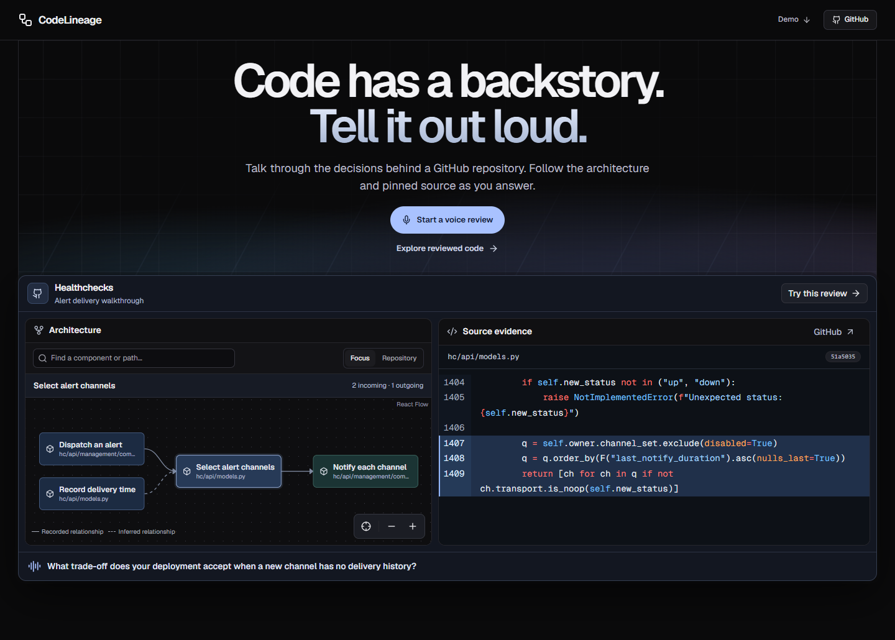
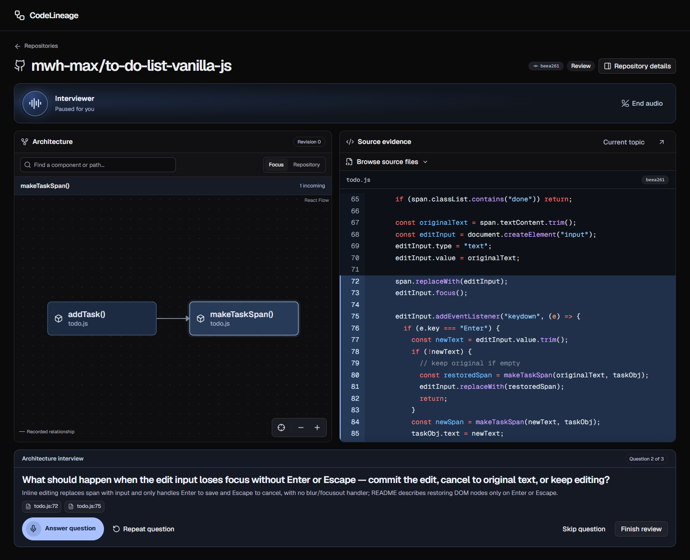
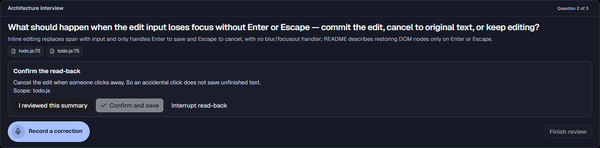
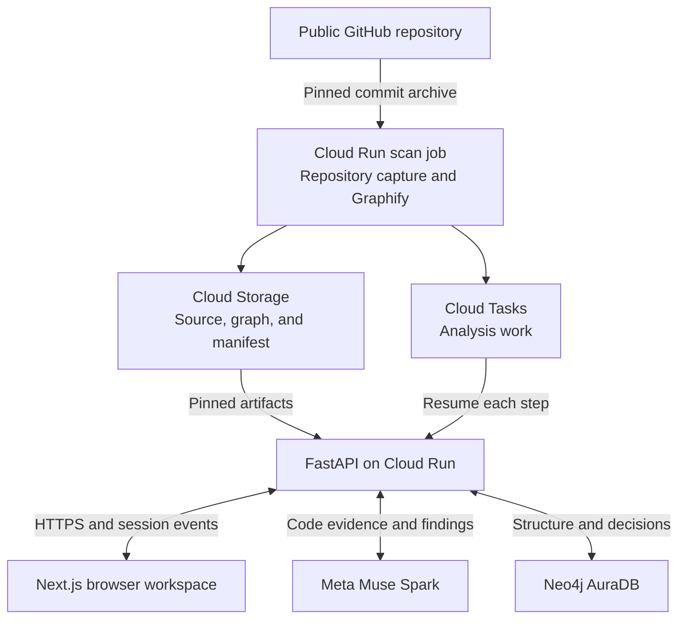
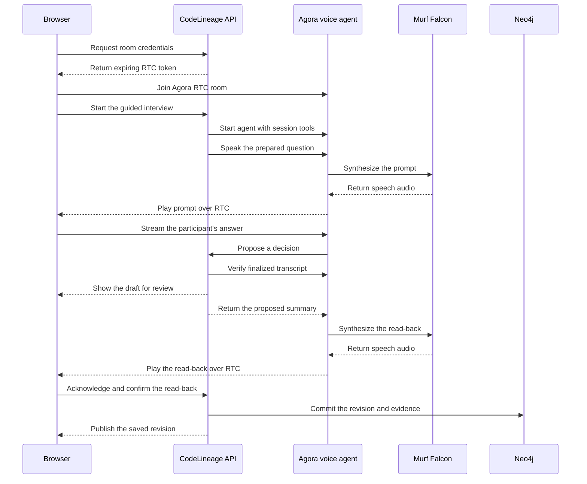

# CodeLineage

**Voice-first architecture interviews for GitHub repositories.**

CodeLineage turns a public repository into an interactive architecture map with source evidence pinned to a commit. The interviewer talks through the decisions the repository leaves open. Confirmed explanations become searchable decisions linked to the code and the interview.

[Open the live app](https://codelineage-872637673792.us-central1.run.app/)

## What you can do

1. **Scan a public repository.** Paste a GitHub URL and optionally choose a ref or directory. Graphify extracts the code structure. Muse Spark reads batches of pinned source, tests, and documentation to suggest decisions worth discussing.
2. **Talk through the open decisions.** The interviewer reads the prepared question and pauses while you look at the diagram and evidence. Use **Answer question** to open the mic and **Finish answer** to submit your reasoning.
3. **Review and save the decision.** Check the read-back, choose **I reviewed this summary**, then **Confirm and save**. CodeLineage records the decision, its scope, and its evidence in a new graph revision.
4. **Ask about the reviewed code.** Open **Explore reviewed code** for a repository with saved decisions. Ask a question aloud to retrieve the relevant explanation and its pinned source.

For a walkthrough, choose **Start a voice review**, **Use the Healthchecks demo**, then **Open review**. The first question covers the trade-off for alert channels without delivery history. The interview screenshots show an example review of a small to-do app. [To-do app source](https://github.com/mwh-max/to-do-list-vanilla-js)

## Screenshots

### Voice interview with pinned evidence

The workspace shows the interviewer, the relevant architecture, and highlighted source lines for the current question.

### Decision read-back

The proposed decision appears with its scope and confirmation controls. The interview transcript becomes evidence for the saved decision after approval.

## System architecture

The API resolves the GitHub ref to a commit and dispatches the scan job. The job captures the source and extracts its structure before queuing semantic review.

Muse suggests questions where the reason behind a decision remains unclear in the excerpts. The API checks each cited quote against the captured commit. Neo4j stores model findings and participant-confirmed decisions with their respective evidence.

## Agora and Murf AI

- **Agora RTC** connects the browser microphone and the agent’s audio in a live room. The API issues expiring room credentials.
- **Agora Conversational AI** runs the voice pipeline, including speech recognition, the conversation model, and session-scoped HTTPS tools. The agent can look up decisions, focus the source panel, and propose a draft.
- **Murf AI Falcon** is the pipeline’s text-to-speech provider. It speaks the interviewer’s questions, read-backs, and answers about previously reviewed code.

The API verifies a new Agora transcript before staging the proposed decision. Confirming the read-back in the browser commits the graph revision. [Agora and Murf integration guide](https://docs.agora.io/en/ai/platform/models/tts/murf) · [Murf streaming speech](https://murf.ai/api/docs/text-to-speech/streaming)

## Run locally

Use Git, Python 3.12–3.14, uv, and Node.js 22 or later.

~~~sh
uv sync --locked
npm --prefix web ci
npm --prefix web run build
uv run --locked uvicorn codelineage.main:app --host 127.0.0.1 --port 8000
~~~

Open [localhost:8000](http://localhost:8000). FastAPI serves the static Next.js export. For frontend hot reload, keep FastAPI running, start `npm --prefix web run dev` in another terminal, and open [localhost:3000](http://localhost:3000). Set `CODELINEAGE_API_ORIGIN` if the frontend should proxy to a different backend.

### Configure voice and semantic review

Copy [`.env.example`](.env.example) to `.env`. Publish an agent in Agora AI Studio with speech recognition, a conversation model, and **Murf Falcon** as text-to-speech. Use the App ID and App Certificate for the project that owns the published agent. [Connect a published Agora agent](https://docs.agora.io/en/ai/studio/deploy/connect-agent)

| Setting | What it configures |
| --- | --- |
| `AGORA_APP_ID` and `AGORA_APP_CERTIFICATE` | Agora project and server-side token signing. |
| `AGORA_PIPELINE_ID` | Published Studio pipeline. CodeLineage attaches its interview instructions and tools when it starts the agent. |
| `CODELINEAGE_PUBLIC_URL` | Public HTTPS origin Agora can reach for `/voice/tools/…`. Use a tunnel or a deployed service when the API runs locally. |
| `CODELINEAGE_ANALYSIS_PROVIDER` and `CODELINEAGE_ANALYSIS_KEY` | Set the provider to `meta` and supply a Meta Model API key for Muse Spark. An OpenAI key with provider `openai` also works. |
| `CODELINEAGE_ANALYSIS_BATCHES` | Maximum number of semantic analysis batches. The default is 40. |
| `NEO4J_URI`, `NEO4J_USER`, `NEO4J_PASSWORD`, and `NEO4J_DATABASE` | Neo4j persistence. Local development can use SQLite and local snapshot files when the URI is empty. |

With the Studio pipeline, set the Murf voice and credentials in Studio. For direct server configuration, leave `AGORA_PIPELINE_ID` empty and set `MURF_API_KEY` and `MURF_VOICE_ID`. The direct path uses Deepgram for transcription and `FALCON` for speech synthesis by default. It supports `DEEPGRAM_API_KEY`, `MURF_MODEL`, and the optional `CODELINEAGE_VOICE_MODEL` and `CODELINEAGE_VOICE_MODEL_KEY` settings.

The Meta configuration defaults to `muse-spark-1.3-contributor`. Use public source without sensitive data because Meta may use Contributor inputs for training. Set `CODELINEAGE_ANALYSIS_MODEL` to override the model. Scans show partial coverage when they reach the analysis budget. [Muse Spark](https://dev.meta.ai/docs/muse-spark)

Start FastAPI with the environment file.

~~~sh
uv run --locked --env-file .env uvicorn codelineage.main:app --host 127.0.0.1 --port 8000
~~~

## Deploy to Cloud Run

Use a billing-enabled Google Cloud project, an authenticated `gcloud` CLI, and the AuraDB and Agora Studio settings in `.env`. The deploy script provisions the service, scan job, task queue, and private snapshot storage. It loads runtime credentials from Secret Manager and sets the Cloud Run HTTPS origin for Agora callbacks.

~~~sh
python deploy/google_cloud.py --check
python deploy/google_cloud.py --project YOUR_PROJECT_ID --region us-central1
python deploy/smoke.py https://YOUR_SERVICE_URL --voice --scan
~~~

Use `--env-file PATH` to load another environment file or `--rotate-secrets` to publish new credential versions.

To configure continuous deployment after the first rollout, run the following command and add its printed variables under **Settings → Secrets and variables → Actions → Variables** in GitHub.

~~~sh
python -m deploy.configure_ci --project YOUR_PROJECT_ID --region us-central1
~~~

The **Deploy to Cloud Run** workflow runs tests and a container smoke test on pushes to `main`. It stages the API revision and updates the scan job to the tested image digest before routing traffic. A failed rollout attempts to restore the previous traffic split and job image. [Deployment workflow](.github/workflows/deploy-cloud-run.yml)

## Tests and graph inspection

~~~sh
uv run --locked pytest
npm --prefix web run build
~~~

Set `CODELINEAGE_TEST_NEO4J_URI` and the matching `CODELINEAGE_TEST_NEO4J_USER`, `CODELINEAGE_TEST_NEO4J_PASSWORD`, and `CODELINEAGE_TEST_NEO4J_DATABASE` values to enable the Neo4j integration test. It uses a synthetic repository and removes its own records.

Use the following query in Neo4j to inspect the captured structure for the built-in Healthchecks demo.

~~~cypher
MATCH p=(r:CodeRepository {name: 'healthchecks/healthchecks'})
  -[:HAS_SNAPSHOT]->(:CodeSnapshot)-[:HAS_FILE]->(:SourceFile {path: 'hc/api/models.py'})
  -[:DEFINES]->(:CodeComponent)-[:CODE_RELATION]->(:CodeComponent)
RETURN p LIMIT 25
~~~

[Build plan and acceptance checks](MILESTONES.md) · [Original design decisions](Agora-Design-Decisions.md)
